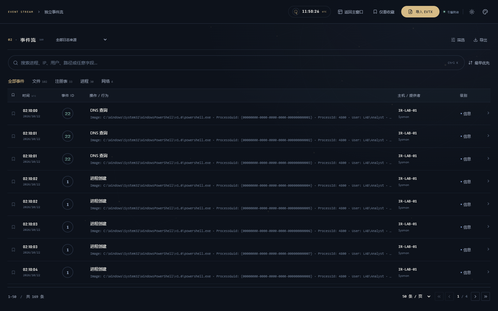
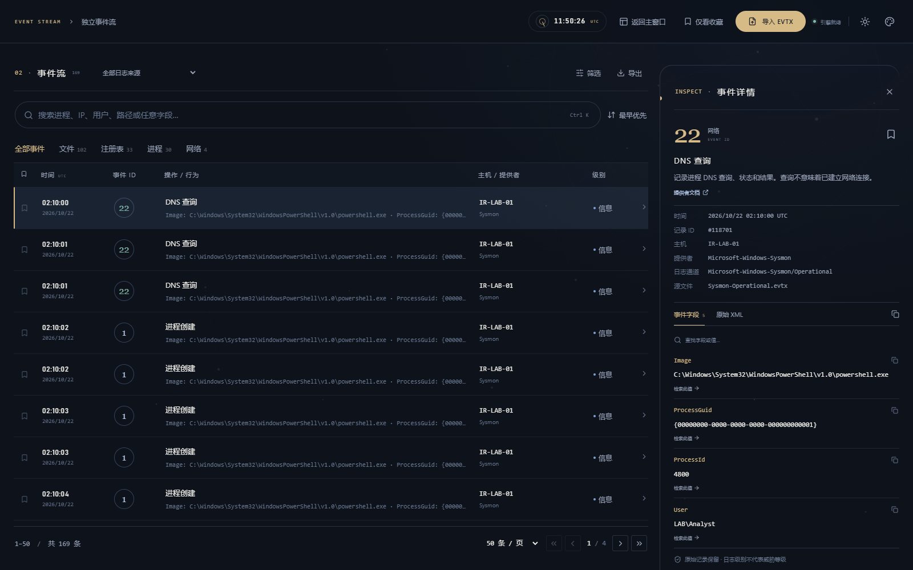
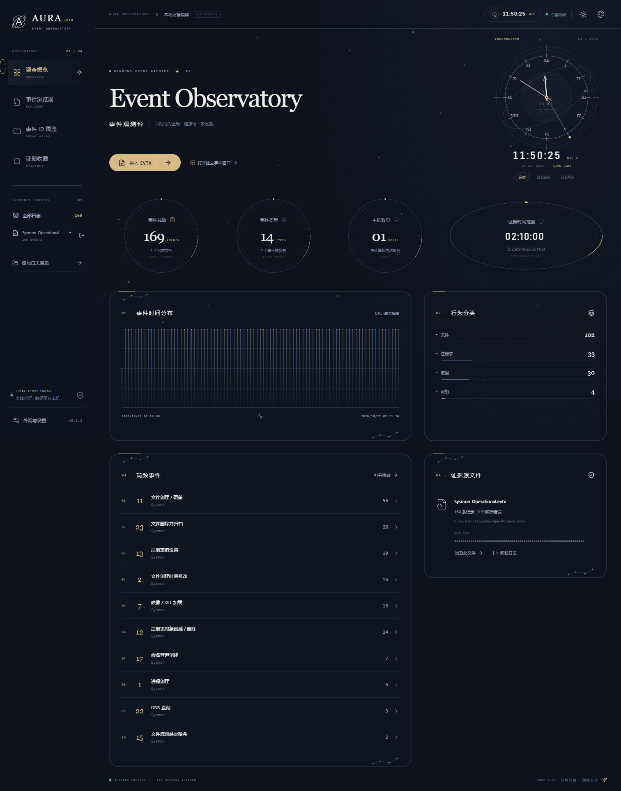
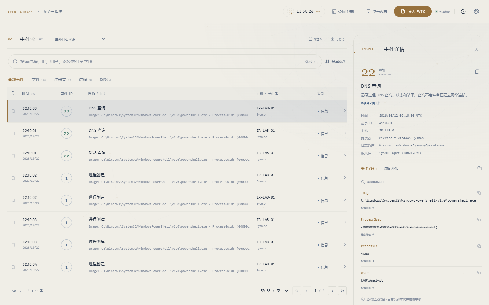

<div align="center">


# AuraEVTX

**让每一条 Windows 事件，都成为看得懂的线索。**

本地 Windows 事件观测台 · Rust 解析 · 独立事件窗口 · 中文事件图鉴

[](https://github.com/JasmineAura/AuraEVTX/releases/latest)
[](https://github.com/JasmineAura/AuraEVTX/releases/latest/download/AuraEVTX-windows-x64.zip)
[](https://github.com/JasmineAura/AuraEVTX/actions/workflows/build.yml)

[下载 Windows 便携版](https://github.com/JasmineAura/AuraEVTX/releases/latest/download/AuraEVTX-windows-x64.zip) · [所有版本](https://github.com/JasmineAura/AuraEVTX/releases) · [反馈问题](https://github.com/JasmineAura/AuraEVTX/issues) · [支持作者](#支持作者)

</div>

AuraEVTX 面向应急响应、日志排查与取证学习。导入 `.evtx` 文件后，可以浏览完整事件、查看常见操作释义、筛选关键记录并导出证据。日志解析、索引与查询都在本机完成，软件不要求上传日志，也不内置任何日志或演示数据。

## 界面演示

截图使用构造的演示事件展示界面，不代表威胁检测结果。发行版打开后是空工作区，需要自行导入日志。

### 独立事件流窗口

事件流在独立桌面窗口中打开，默认最大化。列表占满可用空间，无侧栏或顶部概览挤占；可单独移动到第二块屏幕。



点击一条事件，再展开右侧详情。关闭详情即可恢复全宽列表。



### 调查概览

采用星图与天文钟灵感的布局：圆形刻度仪表、椭圆轨道与对称的小弧度星象边框，搭配留白和低饱和蓝金配色。内容区边框随条目数量伸展，边缘光弧缓慢巡行，动效可关闭。按主机、提供者、行为类别和时间分布查看日志；文件记录保留 SHA-256，可从概览直接跳到独立事件窗口。

天文钟每秒走动，可在实时、日志起点和日志终点之间切换；点击时区切换 UTC / 本地时间，方便对照证据时间。



### 明暗模式与主题

午夜蓝、深海青、暮光紫三套配色，每套均支持明暗模式。主窗口与事件窗口同步外观和时间显示设置；动效可关闭，并尊重系统减少动态偏好。




## 功能

| 能力 | 说明 |
| --- | --- |
| 通用 EVTX 导入 | 不按事件提供者设白名单，支持标准 EVTX、多选文件、目录递归扫描和拖放 |
| 卸载日志 | 从工作区单独移除已导入文件，清理对应事件与收藏，保留原始 EVTX，支持重新导入 |
| 独立事件流 | 最大化独立窗口、按需详情、来源切换、分页和时间排序 |
| 搜索与筛选 | 搜索完整事件文本；按提供者、事件 ID、分类、级别、时间和源文件组合筛选 |
| 中文事件图鉴 | 141 条常见释义，按提供者 + 通道 + ID 区分，覆盖 Security、Sysmon、PowerShell、Defender、防火墙、计划任务、远程桌面等 |
| 完整事件详情 | EventData、UserData、系统元数据、原始 XML，以及字段值快速检索 |
| 证据收藏 | 收藏关键事件，跨窗口同步，应用重启后保留 |
| CSV 导出 | 导出全部筛选结果，包含时间、操作、来源与字段 JSON；UTF-8 BOM 便于 Excel 打开 |
| 本地索引 | SQLite WAL、后台解析、SHA-256 去重、导入进度、取消和错误汇总 |
| 时间与外观 | 实时时钟、日志起止时间定位、UTC / 本地时间、三套主题、明暗切换、星轨动效和减少动态选项 |

**通用导入不等于拥有所有提供者的中文释义。** 未收录事件仍完整入库，并标注“未收录释义”，不会借用其他提供者的同号事件解释。日志级别是诊断级别，不等于威胁等级。当前版本用于浏览和人工调查，尚未集成 Sigma 自动检测。

## 下载与使用

1. 从 [最新 Release](https://github.com/JasmineAura/AuraEVTX/releases/latest) 下载 `AuraEVTX-windows-x64.zip`。
2. 解压后运行 `AuraEVTX.exe`，无需安装。也可在 Release 中单独下载 EXE。
3. 在主窗口选择 **导入 EVTX**，或添加日志目录、拖入文件。
4. 导入后自动打开独立事件流；也可通过左侧 **事件浏览器** 或 **证据收藏** 打开。
5. 搜索、筛选、查看字段，保存收藏，或导出 CSV。
6. 不再需要某份日志时，点击左侧文件旁的卸载图标，或概览“证据源文件”中的 **卸载日志**。独立事件窗口选定日志来源后也可点击 **卸载当前日志**。确认后仅清理工作区索引及对应收藏，原文件保留，其他日志不受影响。

运行环境为 Windows 10/11 x64，需要 [Microsoft Edge WebView2 Runtime](https://developer.microsoft.com/microsoft-edge/webview2/)。Windows 11 通常已经包含此运行时。

当前发行版未进行代码签名。

Release 同时提供 `SHA256SUMS.txt`，可使用 PowerShell 核对下载文件：

```powershell
Get-FileHash .\AuraEVTX-windows-x64.zip -Algorithm SHA256
```

## 数据保存与边界

- 字典更新后，启动时自动同步已导入记录的操作释义与分类；已有防火墙事件不需要卸载重导入，原始字段、XML 与收藏保持不变。
- 所有导入汇集在同一个本地工作区，SQLite 数据库存放在 Tauri `app_data_dir` 下的 `aura.db`。Windows 通常位于 `%APPDATA%\dev.aura.evtx\aura.db`。
- 输入 EVTX 文件保持只读。索引、原始事件与收藏保存在本机；删除工作区数据库会清除本地索引和收藏。
- 取消导入会回滚当前未完成文件，已完成文件保留。无法解析的文件或记录会报告错误，其他可读记录继续处理。
- 卸载按文件执行数据库事务，事件与文件记录一起移除；主窗口和事件窗口同步更新，已卸载来源的筛选与详情自动复位。导入与卸载任务互斥。
- 支持处理 EVTX 字符串中不符合 XML 1.0 的控制字符，保留原始字段值及序列化 XML。
- CSV 导出会处理潜在公式前缀；请选择尚不存在的文件名，避免覆盖已有文件。
- 搜索采用参数绑定的字面子串匹配。列表按页读取，详情按需加载；尚未承诺千万级数据集的性能。
- 点击提供者文档链接会在系统浏览器打开外部文档；日志分析本身不依赖网络。

## 本地开发

需要 Node.js 22、Rust MSVC 工具链、Visual Studio C++ Build Tools 和 WebView2。

```powershell
npm ci
npm run desktop
```

只预览界面可使用 `npm run dev`。浏览器预览不提供本地日志导入，也不携带演示日志；完整功能请使用 Tauri 桌面端。

### 构建 Windows Release

```powershell
npm run desktop:build
./scripts/package-windows.ps1
```

产物：

```text
release/
├── AuraEVTX.exe
├── AuraEVTX-windows-x64.zip
└── SHA256SUMS.txt
```

打包脚本会检查发行包，拒绝将 EVTX、数据库或测试资料带入。仓库的 Windows 构建工作流也会生成可下载产物。

### 验证

```powershell
npm run build
npm test
npm run test:rust
```

前端测试使用 Edge，并在测试浏览器中注入构造数据；生产代码不包含测试传输层。覆盖独立窗口、全宽布局、分页、检索、详情、收藏、图鉴、跨窗口主题同步、时钟走时、证据时间定位、时区换算、最小窗口尺寸，以及边框动画与减少动态设置。

在有图形桌面的 Windows 上，构建打包后还可执行 `./scripts/verify-native-window.ps1`：直接操作本次启动的原生窗口，检查最大化及跨窗口导航隔离，结束后关闭它自己启动的进程。

`./scripts/verify-generic.ps1` 会下载解析器上游的公开 EVTX 测试文件，与 Windows `Get-WinEvent` 核对；历史核验结果为 Security 2,261 条、System 1,881 条、Application 6,419 条。真实日志测试默认跳过，资料保存在本地忽略目录，不进入发行版。

事件字典维护入口为 `scripts/generate-catalog.mjs`，修改后运行 `node scripts/generate-catalog.mjs`。需要刷新文档演示截图时，在开发服务器启动后运行 `node scripts/capture-preview.mjs`。

快捷键：`Ctrl+O` 导入，`Ctrl+K` 打开事件窗口 / 聚焦搜索，`Enter` 打开事件详情，`Esc` 关闭详情。

## 技术栈与致谢

[Tauri 2](https://tauri.app/) · [React](https://react.dev/) · TypeScript · [Rust evtx](https://github.com/omerbenamram/evtx) · SQLite · [Lucide](https://lucide.dev/)

感谢相关开源项目，以及微软提供的事件与 Sysmon 文档。事件释义的参考来源可从软件中的图鉴卡片打开。

## 支持作者

如果 AuraEVTX 帮助你节省了排查时间，欢迎点一个 Star、提交反馈，或者请作者喝杯咖啡。打赏完全自愿，不影响任何功能的使用。

<div align="center">

<br />
<strong>微信扫码支持 JasmineAura，感谢支持！</strong>
</div>
